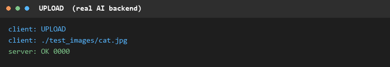
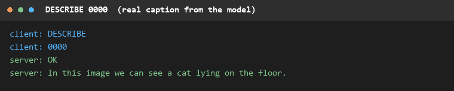
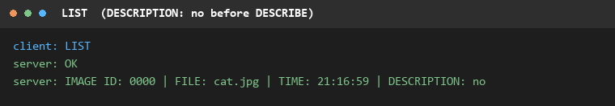

# Online Image Description System

A multi-threaded TCP server and an interactive client for a small shared image
bank: upload a picture, list what is stored, ask a vision-language model to
describe it, download it back, and remove it. Everything runs on one machine —
the model is loaded from disk and runs on the CPU, so no API key and no network
access are needed.

Coursework for **CS3201 Computer Networks**, City University of Hong Kong.

## Screenshots







The transcripts above are real client/server sessions rendered to images.

## Features

- Six commands over **one persistent TCP connection**: `UPLOAD`, `LIST`,
  `DESCRIBE`, `DOWNLOAD`, `REMOVE`, `QUIT`.
- **Length-prefixed framing** (10 ASCII digits + payload) so binary images and
  short text commands can share a byte stream safely.
- **One worker thread per client**; all clients share one image store, so an
  upload by one client is visible to every later connection.
- Captions are generated **lazily on the first `DESCRIBE`** and cached; later
  requests return the stored caption immediately.
- **Every error keeps the connection usable** — a bad command, a missing file or
  an unknown id produces `ERROR - ...` and the same connection keeps working.
- `--backend mock` answers with a fixed caption, which makes protocol tests run
  in seconds without loading the 494 MB model.

## Architecture

```
 ImageDescriptionClient.py                ImageDescriptionServer.py
 ┌───────────────────────┐    TCP 18333  ┌──────────────────────────────┐
 │ read stdin, one       │◄────────────► │ main thread: accept() loop   │
 │ command per line      │   messages    │ worker thread per client     │
 │ print "client: " /    │               │        │                     │
 │       "server: "      │               │        ▼                     │
 └───────────────────────┘               │  ImageStore (one lock)       │
                                         │  max 20 images / 50 MiB      │
                                         │  ids 0000.. never reused     │
                                         │        │ first DESCRIBE      │
                                         │        ▼                     │
                                         │  SmolVLM-256M on CPU         │
                                         └──────────────────────────────┘
```

The client keeps its own copy of the framing helpers instead of importing the
server module, because importing the server would also load the model and its
dependencies.

## Protocol

Every message is a fixed 10-byte header followed by the payload:

```
0000391425<391425 bytes of image data>
└──┬───┘└──────────┬──────────┘
   │               └─ payload, 1 .. 5 MiB
   └─ ASCII decimal length of the payload, zero padded to 10 digits
```

TCP is a byte stream and has no message boundaries, so the receiver reads the
header, converts it to an integer and then reads exactly that many bytes. This
is what lets an image that contains newline bytes travel next to a text command.

| Command | Client sends | Server replies |
| --- | --- | --- |
| `UPLOAD` | `UPLOAD <name>`, then the raw image bytes as a second message | `OK <id>` |
| `LIST` | `LIST` | one message: `OK`, then one line per image — `IMAGE ID: 0000 \| FILE: cat.jpg \| TIME: 21:16:59 \| DESCRIPTION: no` (or `No images`) |
| `DESCRIBE <id>` | `DESCRIBE <id>` | one message: `OK` and the caption on the following line |
| `DOWNLOAD <id> [name]` | `DOWNLOAD <id>` | `OK <name>`, then the image bytes as a second message |
| `REMOVE <id>` | `REMOVE <id>` | `OK` |
| `QUIT` | `QUIT` | `OK`, then the server closes the connection |

Errors are a single message that starts with `ERROR - `:

| Input | Reply |
| --- | --- |
| not a command | `ERROR - Command not understood` |
| `UPLOAD` with a file that is not an image | `ERROR - Invalid image` |
| `UPLOAD` with a name that has a path separator or over 255 characters | `ERROR - Invalid filename` |
| `DESCRIBE` / `DOWNLOAD` / `REMOVE` with an unknown id | `ERROR - Invalid ID` |
| `UPLOAD` when the store is full | `ERROR - Image storage is full` |
| local file missing or too large | reported by the client, nothing is sent |

Limits: payload 1 .. 5 MiB, command line at most 1024 bytes, file name at most
255 characters, store at most 20 images or 50 MiB in total.

## Getting started

Requires **Python 3.11** (the pinned `torch` wheel in `requirements.txt` needs it).

```bash
git clone https://github.com/KevinLIN719/cs3201-image-description.git
cd cs3201-image-description
python -m venv .venv
.venv\Scripts\pip install -r requirements.txt      # macOS / Linux: .venv/bin/pip
```

The model weights (~494 MB) are not committed. Download them once; the server
verifies the SHA-256 of every file it fetches:

```bash
.venv\Scripts\python.exe ImageDescriptionServer.py --download-model
```

Start the server in one terminal. It loads the model (about 20 s on a CPU) and
then prints `READY host=0.0.0.0 port=18333`:

```bash
.venv\Scripts\python.exe ImageDescriptionServer.py
```

Start the client in a second terminal:

```bash
.venv\Scripts\python.exe ImageDescriptionClient.py 127.0.0.1 18333
```

Then type one command per line. A command that needs an argument can take it on
the same line (`UPLOAD test_images/cat.jpg`) or on the next line, as shown here:

```
client: UPLOAD
client: test_images/cat.jpg
server: OK 0000
client: DESCRIBE 0000
server: OK
server: In this image we can see a cat lying on the floor.
client: QUIT
server: OK
```

To try the protocol without the model, start the server with
`--backend mock`; captions are then a fixed string and no weights are loaded.

### Server options

| Option | Default | Meaning |
| --- | --- | --- |
| `--host` | `0.0.0.0` | listening address, all interfaces |
| `--port` | `18333` | listening port |
| `--backend` | `real` | `real` runs the model, `mock` returns a fixed caption |
| `--threads` | `2` | CPU threads used for inference |
| `--io-timeout` | `300` | socket timeout in seconds |
| `--model-dir` | `models/smolvlm-256m` | where the weights live |
| `--download-model` | – | download / repair the weights and exit |
| `--check-ai IMAGE` | – | caption one image and exit, useful to check the model |

## Tests

All scripts start the real server (in `--backend mock` mode unless noted) and
drive the real client, then print their own pass/fail summary and exit non-zero
on failure. Run them from the project root with the virtual environment Python:

```bash
.venv\Scripts\python.exe tests\test_server_protocol.py
.venv\Scripts\python.exe tests\test_client_skeleton.py
.venv\Scripts\python.exe tests\test_client_commands.py
.venv\Scripts\python.exe tests\error_matrix.py
.venv\Scripts\python.exe tests\test_lan_shared.py     # real model, takes ~1 min
```

| Script | Covers |
| --- | --- |
| `test_server_protocol.py` | header format, round trips on several sizes, EOF before and inside a message |
| `test_client_skeleton.py` | exact `client: ` / `server: ` prefixes, `QUIT`, unknown command |
| `test_client_commands.py` | the five data commands end to end, including binary payloads |
| `error_matrix.py` | the eight required error cases, each followed by a `LIST` on the same connection to prove it survived |
| `test_lan_shared.py` | real backend, two clients sharing one store, server bound on a LAN address |

`error_matrix.py` also accepts `--case N` to run a single case.

## Project layout

```
ImageDescriptionServer.py   multi-threaded server (protocol, store, local model)
ImageDescriptionClient.py   interactive client
requirements.txt            pinned runtime dependencies
requirements.lock.txt       full lock file produced by the provided setup script
setup_env.sh / setup_env.bat  provided environment setup (uv)
tests/                      self-tests, error matrix, screenshot generator
test_images/                sample images and their sources
docs/images/                screenshots used in this README
models/smolvlm-256m/        model weights (downloaded, ignored by git)
```

## Notes

- `setup_env.sh`, `setup_env.bat`, `requirements.lock.txt` and `test_images/`
  came with the assignment and are included unchanged so the project can be
  reproduced. The client and the server logic are mine; the server file also
  contains the provided model and protocol helpers, marked as given in its
  comments.
- The model is [SmolVLM-256M-Instruct](https://huggingface.co/HuggingFaceTB/SmolVLM-256M-Instruct)
  by Hugging Face, Apache-2.0. It runs on the CPU and needs no GPU.
- The `models/`, `.venv/` and `shots/` directories are ignored by git: weights
  are large and the environment is machine-specific.

## Author

[@KevinLIN719](https://github.com/KevinLIN719)
